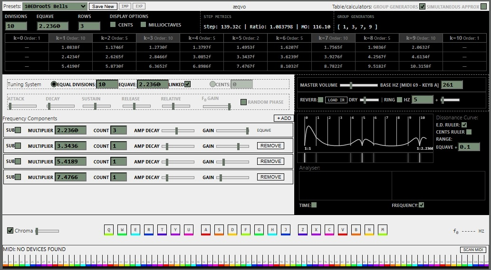

[**Aeqvo**](https://jbcristian.github.io/xeneize/app/aeqvo.html)

1. [Spectral Congruence and Pitch Cyclicity](#spectral-congruence-and-pitch-cyclicity)
    1. [Review and Context](#1-review-and-context)
        1. [Introduction](#11-introduction)
        2. [Pitch Height, Chroma, and Cyclic Representations](#12-pitch-height-chroma-and-cyclic-representations)
        3. [Harmony, Consonance, and Spectral Structure](#13-harmony-consonance-and-spectral-structure)
    2. [Spectral Congruence and the Emergence of Pitch Cycles](#spectral-congruence-and-pitch-cyclicity)
        1. [Spectral Self-Similarity Under Scaling](#21-spectral-self-similarity-under-scaling)
        2. [Simple Examples](#22-simple-examples)
    3. [Constructing Timbres Compatible with a Given Pitch Cycle](#3-constructing-timbres-compatible-with-a-given-pitch-cycle)
        1. [Starting from the Equave](#31-starting-from-the-equave)
        2. [Equal Divisions of the Equave](#32-equal-divisions-of-the-equave)
        3. [Generator Structure](#33-generator-structure)
        4. [Timbre-Tuning Interaction](#34-timbre-tuning-interaction)
        5. [Finding a Compatible Equal Division](#35-finding-a-compatible-equal-division)
        6. [Multiple Generators](#36-multiple-generators)
        7. [Multiple Spectral Cycles and Equave Precedence](#37-multiple-spectral-cycles-and-equave-precedence)
        8. [Clarifying the Meaning of Scaling Symmetry](#38-clarifying-the-meaning-of-scaling-symmetry)
        9. [Alternative Sound Design](#39-alternative-sound-design)
    4. [Discussion and Analysis](#4-discussion)
        1. [Music Theory](#41-music-theory)
        2. [Psychoacoustics and Psychology](#42-psychoacoustics-and-interval-affect)
    5. [A. Math extensions:](#a-math-extensions)
        1. [Spectra as algebra](#a0-spectra-as-algebra)
        2. [Multidimensional timbres](#a1-multidimensional-timbres)
        3. [Mathematical representation of Chroma](#a2-mathematical-representation-of-chroma)
        4. [Measuring Spectral Congruence](#a3-measuring-spectral-congruence)
2. [Aeqvo Manual](#aeqvo-manual)
    

---
---

# Spectral Congruence and Pitch Cyclicity 

Pitch cyclicity (including octave equivalence) can be understood as an emergent perceptual strategy and property of spectral self-similarity under frequency scaling; by designing or analyzing spectra for scaling symmetries one can predict or create alternative perceptual pitch cycles and compatible tuning systems.
s
"Aeqvo" screenshot.

Existing models of pitch perception successfully account for consonance and sensory dissonance relationships between sounds, but they do not generally explain why pitch space is perceived as cyclic at a specific interval. This work demonstrates that octave equivalence arises as a special case of a more general principle of spectral congruence: chroma-equivalent pitch categories emerge when the spectral structure defining a timbre remains approximately invariant under frequency scaling. Under this formulation, the perceived pitch cycle (equave) is not fixed but depends on the spectral properties that define pitch identity: chroma-equivalence as a consequence of spectral congruence under frequency scaling

Computational demonstrations show how spectra with controlled scaling symmetries can produce alternative pitch cycles and corresponding tuning systems. An interactive implementation enables the co-design of timbre and tuning by directly manipulating the spectral parameters that determine the distance of the perceptual equave. The approach provides a framework for constructing compatible timbres and musically practical tuning systems while also revealing edge cases in which pitch cyclicity weakens or fails to emerge.

## 1. Review and Context

### 1.1 Introduction

The concept of pitch is broadly consistent across fields such as auditory perception, psychoacoustics, and music theory. It is commonly defined as *"that auditory attribute of sound according to which sounds can be ordered on a scale from low to high."* For simple stimuli such as pure tones, this ordering closely corresponds to frequency. However, for complex sounds, pitch is often described as something that must be extracted from the signal rather than directly given (Oxenham, 2004).

Importantly, not all sets of sounds can be meaningfully arranged along a single low-high continuum, even when each sound individually is perceived as pitched. This suggests that the existence of a continuous pitch dimension depends on constraints beyond pitch itself. In practice, such ordering is facilitated when sounds share a similar timbre that is, a comparable spectral composition, such as notes produced on a single instrument. Under these conditions, pitch becomes a stable perceptual attribute, supported by approximate invariance under spectral scaling and the formation of coherent auditory objects (Bregman; Terhardt).

However, the existence of pitch within a given timbre does not guarantee comparability across timbres. Sounds with distinct spectral structures may each exhibit clear pitch height, yet fail to align perceptually. For example, highly inharmonic or irregular resonant systems can produce well-defined pitch-like percepts that do not admit a clear unison relationship with harmonic tones. This suggests that pitch equivalence, the degree to which two sounds are perceived as equivalent or substitutable, is itself dependent on timbre.

Pitch equivalance, or also affinity, refers to the perceptual similarity between sounds: the extent to which one sound may be confused with, or replace, another. Within harmonic timbres, the strongest equivalence occurs at unison, followed by the octave, corresponding to a doubling of frequency (1:2). This relationship is widely observed across musical cultures and has historically served as the foundational interval for scale construction. The resulting phenomenon, known as octave equivalence, is often treated as universal (Burns & Ward).

Crucially, octave equivalence does more than establish similarity between discrete sounds. Because it arises from a continuous transformation (frequency scaling), it induces a topological structure on pitch space: a cycle. In this way, pitch is not merely ordered linearly, but organized into repeating classes. This cyclic structure provides a stable perceptual framework that supports categorization, largely independent of individual differences in hearing range or discrimination thresholds. Pitch equivalence thus functions as a perceptual strategy for structuring an otherwise continuous auditory dimension.

Empirical studies, however, reveal that the octave is not perceived as a fixed interval. For example, Lola L. Cuddy (1982) found that listeners tend to stretch the octave when tuning sine waves, while accuracy improves in musically structured contexts such as triads. Similarly, tuning practices in instruments such as the piano exhibit systematic deviations from the ideal 1:2 ratio. These findings suggest that octave equivalence, while robust, is not exact, and may reflect underlying perceptual and physiological constraints. At the same time, its presence even in simple stimuli has been linked to internal auditory templates and mechanisms associated with virtual pitch (Terhardt).

Moreover, pitch perception is strongly shaped by context. Musical expectation and cognitive factors influence how sounds are categorized, beyond their raw spectral content. Phenomena such as the ambiguity of Shepard tones, or the functional reinterpretation of identical pitch material in different harmonic contexts, illustrate that pitch perception is not a passive reflection of acoustic input. These effects have been extensively studied by researchers such as Diana Deutsch and Carol Krumhansl.

The origins of octave equivalence remain debated. Hermann von Helmholtz proposed that it arises from shared spectral components between tones separated by a 1:2 ratio. In contrast, more recent work by Peter A. Cariani and Bertrand Delgutte (1996) suggests that octave equivalence may emerge from neural coding strategies, rather than from spectral similarity alone.

Closely related to equivalence is the concept of consonance. Originally formalized by Helmholtz, modern psychoacoustics explains sensory dissonance in terms of roughness arising from interactions within critical bandwidths. Building on this, William A. Sethares developed a model linking timbre and tuning, showing that consonant intervals correspond to minima in the dissonance curve derived from spectral interactions (following Reinier Plomp and Willem J. M. Levelt). This framework enables the derivation of optimal tuning systems for a given timbre, although the inverse problem, constructing timbres for a desired set of intervals, remains computationally difficult.

Despite these advances, existing models do not explain why certain intervals such as the octave become perceptual equivalence classes, nor why pitch space assumes a cyclic structure. In other words, while consonance models account for interval preference, they do not account for the emergence of categorical periodicity in pitch.

The model introduced in this work addresses this gap by explaining pitch equivalence and cyclicity without requiring a commitment to specific mechanisms of pitch encoding, such as place-based or temporal theories.

### 1.2. Pitch Height, Chroma, and Cyclic Representations

Geza Revesz, William L. Idson, and Dominic W. Massaro proposed that pitch should be understood as a two-dimensional perceptual attribute, in which pitch height constitutes only one dimension. The second dimension, termed chroma, refers to the cyclical, categorical aspect of pitch. Within this framework, a tone is characterized both by its height (low to high) and by its position within a repeating set of pitch categories, often associated with musical functions such as "fifth-ness," "leading-tone-ness," or, most fundamentally, "octave-ness," which provides the reference frame for the others.

This dual structure is commonly represented using a helical model. In this representation, pitch height corresponds to vertical position, while chroma is mapped to angular position around the helix. Tones sharing the same chroma (e.g., those labeled with the same pitch class in musical notation) align vertically, separated by octave intervals.

The most influential formalization of this idea is the pitch helix introduced by Roger Shepard and later developed by Diana Deutsch. In this model, pitch height corresponds to logarithmic frequency, while chroma corresponds to position modulo octave. Formally, this can be expressed as a mapping of frequency onto a circular dimension, such that tones separated by a factor of $2$ occupy the same angular position, reflecting octave equivalence.

Conventional accounts typically explain octave equivalence by noting that harmonic spectra exhibit self-similarity under doubling of frequency. The central claim of the present work generalizes this idea: octave equivalence is not unique, but rather a specific instance of a broader principle. Pitch cycles arise whenever a timbre exhibits sufficient spectral congruence under frequency scaling. Under this view, the equave depends on the spectral structure of the sound, and need not be fixed at a 1:2 ratio. If a spectrum is approximately invariant under scaling by a factor $k$, then pitch equivalence may emerge at that ratio.

It is important to distinguish this perceptual notion of equivalence from the concept of pitch class as used in music theory. In many theoretical contexts, pitch classes function as abstract labels akin to equivalence classes in algebra used for analytical purposes. While in standard twelve-tone equal temperament chroma and pitch class coincide, this correspondence is not necessary. Musicians frequently impose alternative analytical structures, for example by redefining equivalence relationships for purposes of reharmonization or compositional experimentation.

Such distinctions become more evident in non-standard tuning systems. For example, in the Bohlen-Pierce scale, the period is often described as a "tritave" (3:1 ratio). Although equal divisions of this interval (e.g., 13-EDT) define a repeating structure analytically, this does not imply perceptual equivalence in the same sense as octave equivalence in harmonic spectra. When realized on harmonic instruments, such systems may produce continuously expanding chroma rather than stable repetition, and the assigned pitch classes do not necessarily correspond to perceptual identity.

This highlights a key point: analytical structure does not guarantee perceptual equivalence. In practice, however, musical systems tend to align these two aspects. A clear example is found in transcription across instruments. For instance, Clair de Lune by Claude Debussy spans a wide range on the piano, yet can be effectively adapted to instruments with a more limited range, such as the guitar, by compressing distant octaves. Despite these transformations, the piece remains recognizable because octave equivalence preserves functional relationships. By contrast, substituting intervals based on a different periodicity (e.g., tritave equivalence) would fundamentally disrupt these relationships and compromise recognition.

At the same time, pitch perception is not strictly determined by chroma. Experimental evidence shows that pitch contour can dominate categorical identity, and that listeners tolerate significant deviations from exact tuning (e.g., stretched octaves) without loss of recognition. While some have argued that chroma is therefore a weaker or secondary perceptual dimension, such conclusions may be overstated. Octave equivalence does not imply identity of sound, but rather a structured form of perceptual similarity.

Particularly revealing are the stimuli described by Roger Shepard as "perfect octaves," which give rise to well-known auditory illusions such as Shepard tones and the endlessly ascending or descending scale. In these cases, spectra are constructed to exhibit near-perfect self-similarity across octave shifts, making tones separated by a factor of 2 difficult to distinguish. The resulting perceptual ambiguity can produce bistable interpretations of pitch direction, depending on context.

This phenomenon extends to the tritone paradox described by Diana Deutsch, in which pairs of tones separated by a tritone can be perceived as ascending or descending depending on prior context. Within the helical framework, this can be understood as a consequence of cyclic structure: if pitch space contains a point of return (octave equivalence), it must also contain perceptual oppositions that generate directional ambiguity. However, such effects depend on specific spectral conditions and do not arise for all pitched sounds.

This suggests that the pitch helix is not a universal representation directly tied to all pitch perception, but rather an emergent structure that applies under particular spectral conditions. In this sense, cyclic pitch organization may reflect a perceptual strategy rather than a fixed property of auditory processing.

The notion of "perfect octaves" can be generalized as a form of autocorrelation in log-frequency space. This principle underlies the synthesis methods used in the present work to construct and test alternative pitch cycles. While some generated sounds may occupy ambiguous positions with respect to pitch, the presence of analogous perceptual effects such as cyclic equivalence and directional ambiguity suggests that spectral self-similarity plays a central role in the formation of pitch categories.

### 1.3. Harmony, Consonance, and Spectral Structure

The systematic study of harmony, as traditionally conceived in music theory, is complicated by the influence of aesthetic and cultural factors, which often obscure more fundamental perceptual mechanisms. Models that classify harmony in terms of chords, dyads, or triads tend to produce inconsistent results, as perceived consonance depends strongly on musical context. For example, a major triad evaluated in isolation may receive a moderate rating, yet be judged significantly more consonant when it follows a dominant or leading-tone context. Conversely, the same chord, removed from context, may be perceived as less stable. This suggests that consonance is not an inherent property of the triad itself, but emerges within a broader tonal framework.

Traditional theory emphasizes intervals defined by simple integer ratios as the foundation of consonance, a view supported by the harmonic series of vibrating strings. However, this principle has remained largely heuristic, functioning more as an intuitive guideline than as a predictive or explanatory model.

To address this, psychoacoustic research has focused on sensory consonance, isolating it from musical structure. This line of work examines roughness and beating phenomena arising from interactions between nearby frequency components.

Hermann von Helmholtz first proposed that consonance is governed by auditory roughness. Building on this idea, Reinier Plomp, Willem J. M. Levelt, and others formalized the relationship between roughness and interval perception through the concept of critical bandwidth, leading to the development of dissonance curves for both pure and complex tones.

While early interpretations suggested that these curves did not align with musically significant intervals, later work by William A. Sethares demonstrated that, when extended to complex spectra, the minima of total roughness across all frequency pairs do in fact correspond closely to conventional musical intervals. In harmonic spectra, these minima often align with intervals found in 12-tone equal temperament or simple rational ratios, thereby linking sensory dissonance with established tuning systems.

This framework provides a powerful method for relating timbre to optimal tuning systems. However, it primarily accounts for simultaneous (vertical) combinations of tones. It does not fully explain the perception of intonation in sequential (melodic) contexts, where judgments of pitch accuracy cannot be reduced to instantaneous spectral interactions alone. Moreover, its integration with broader theories of perceptual organization and category formation remains limited.

An additional complication arises from the presence of combination tones generated by nonlinear processes in the cochlea, as shown by Sylvain Pressnitzer and Roy D. Patterson (2001). These effects reintroduce spectral components that are not explicitly present in the stimulus, making precise control of perceived timbre more difficult.

***In summary, given a timbre understood as a spectral profile it is possible to compute a dissonance function and identify intervals that are physiologically consonant. However, this still leaves an open question: which of these intervals, if any, becomes a perceptual equivalence class, and why?***

## 2. Spectral Congruence and the Emergence of Pitch Cycles

The idea that pitch equivalence may arise from spectral self-similarity across frequency scaling is not new. As discussed previously, various researchers have suggested that perceptual equivalence, particularly octave equivalence, can be explained either through acoustic structure or through neural coding mechanisms. Computational approaches have also explored related ideas by analyzing self-similarity within existing sounds.

Rather than analyzing arbitrary signals for such patterns, the approach taken here is constructive. Instead of searching for spectral self-similarity, we directly generate spectra that contain it by design. The well-known example of Shepard tones provides a clear illustration of this principle: spectra composed of octave-spaced partials exhibit perfect self-similarity under scaling by a factor of two. However, there is nothing intrinsically unique about the octave in this construction. Similar structures can be generated using other scaling ratios.

The central idea is simple. A timbre can be understood as a spectral distribution, and frequency scaling corresponds to multiplying all frequencies by a constant factor. When a spectrum closely matches a scaled copy of itself, we say that the sound exhibits spectral congruence.

### 2.1 Spectral Self-Similarity Under Scaling

Let the spectrum of a timbre be represented as $S(f)$, where $S(f)$ denotes the amplitude (or energy) at frequency $f$. In other words, the spectrum describes how acoustic energy is distributed along the tonotopic frequency axis.

Spectral congruence occurs when the spectrum is approximately invariant under scaling by a factor ($r$):

$$S(f) \approx S(rf)$$

Here $r$ is a scaling factor that produces maximal alignment between the spectrum and its scaled copy.

If this condition holds strongly for some value of $r$ , then tones related by this scaling are expected to produce highly similar spectral patterns in the auditory system. Under these circumstances, listeners may treat tones separated by the factor $r$ as perceptually equivalent.

The scaling factor $r$ therefore defines a pitch cycle, or equave.

### 2.2 Simple Examples

The principle becomes clear in simple synthetic spectra.

A spectrum constructed from octave-spaced partials

$$f, 2f, 4f, 8f, 16f, \dots$$

is invariant under scaling by a factor of two. Scaling the spectrum by two simply translates the pattern:

$$2f, 4f, 8f, 16f, 32f, \dots$$

The same idea applies to other scaling ratios. For example, a spectrum built from powers of three,

$$f, 3f, 9f, 27f, \dots$$

exhibits self-similarity under scaling by a factor of three, producing a "tritave" cycle rather than an octave cycle.

In general, constructing spectra using a multiplicative generator automatically embeds a preferred scaling periodicity into the sound. When such spectra are synthesized, the resulting tones provide minimal examples of timbres with a specified pitch cycle.

These structures also inherit many of the perceptual effects associated with Shepard tones, including cyclic pitch relationships and directional ambiguities.

In this framework, octave equivalence is not a special property of pitch perception, but a consequence of the spectral structure of harmonic sounds.

The next section extends this framework to richer spectral constructions, demonstrating how timbre and tuning can be co-designed to produce musically usable systems with alternative pitch cycles.

## 3. Constructing Timbres Compatible with a Given Pitch Cycle

The previous section introduced spectral congruence as the mechanism underlying pitch cycles. The next question is how to construct richer timbres that preserve this property while supporting musically usable tuning systems.

Two complementary approaches are explored. The first begins by specifying the pitch cycle (equave) and derives compatible timbres and scales. The second starts from spectra and constructs a tuning structure that reinforce it.

### 3.1 Starting from the Equave

Suppose a pitch cycle is defined by a scaling ratio ($q$). For example, consider the case

$$q = 2.71$$

A minimal spectrum exhibiting this cycle can be generated from the sequence

$$f, qf, q^2 f, q^3 f, \dots$$

This construction produces a spectrum that is invariant under scaling by $q$, ensuring strong spectral congruence at that ratio.

While such spectra already demonstrate the principle, musical practice typically requires more structure. In particular, tuning systems usually satisfy two practical conditions:

- they allow transposition and modulation, which favors equal divisions of the equave;
- they contain a manageable number of notes, typically corresponding to step sizes between roughly 25 and 250 cents.

Given an equave $q$, one can therefore explore equal divisions of the equave, analogous to equal temperament but with a different periodic interval.

### 3.2 Equal Divisions of the Equave

Let $N$ denote the number of divisions of the equave. The step size in cents is then

$$s = \frac{1200 \log_2(q)}{N}$$

For example, if

$$q = 2.71$$

then the equave size is approximately

$$1200 \log_2(2.71) \approx 1725 \text{ cents}$$

If the equave is divided into $N=11$ equal steps, the step size becomes

$$s \approx 156 \text{ cents}$$

The resulting tuning consists of the set

$${ ks \pmod{q} \mid k = 0,\dots,N-1 }$$

### 3.3 Generator Structure

The structure of such tuning systems depends on the modular properties of $N$. In particular, the interaction between spectral partials and scale steps can be understood in terms of generators of the cyclic group $\mathbb{Z}_N$.

If $N$ is prime, every non-zero step is coprime with $N$, and therefore acts as a generator of the group. In this case, interactions between partials and scale degrees distribute across all pitch classes.

For example, if $N=11$, any step size generates the entire set of pitch classes.

By contrast, when $N$ is composite, only those integers that are coprime with $N$ act as generators. For instance, when $N=12$, the generators are

$${1,5,7,11}$$

Using partial generators corresponding to non-coprime values (such as 2 or 3) produces spectra whose interactions with the tuning occupy only a subset of pitch classes. In such cases additional chromatic material may emerge when higher partials are considered.

### 3.4 Timbre-Tuning Interaction

This perspective highlights an important point: spectral structure and tuning structure interact through their shared modular organization.

Partial generators define the distribution of spectral energy, while the equal division determines the available pitch classes. Their interaction determines how spectral components reinforce or destabilize particular intervals.

In the computational implementation developed for this work, once an equave and division number are specified, the system enumerates possible generators and visualizes the resulting spectral–tuning interactions.

The next section explores the complementary approach, in which a desired spectra is specified first, and compatible tuning systems are derived to maximize congruence.

### 3.5 Finding a Compatible Equal Division

In the previous construction the equave was fixed first, and equal subdivisions were explored afterward. This revealed that a given equave admits many possible timbre-tuning combinations through different spectral generators.

A complementary situation arises when part of the spectral structure is already fixed. For example, while exploring timbre one might choose an equave $q$ together with an additional spectral generator $g$, producing a spectrum containing components

$$f, qf, g f, qg f, q^2 f, \dots$$

In this case the available freedom is reduced: not every equal division of the equave will align well with the spectral structure. Instead, the problem becomes determining whether there exists an equal division of the equave that approximates the interaction between the generators.

#### Logarithmic representation

The relationship between the two generators becomes simpler in logarithmic coordinates. Let

$$x = \log_q(g)$$

which expresses the generator $g$ as a fraction of the equave in log space.

For example, if

$$q = 2.71, \qquad g = 1.49$$

then

$$x = \log_q(g) \approx 0.3999$$

In this representation, successive powers of $g$ correspond to rotations on the unit interval:

$$k x \pmod{1}$$

This sequence determines how the spectral generator distributes partials across the pitch cycle.

#### Approximating the rotation with an equal division

To construct an equal division that captures this structure, we approximate $x$ by a rational number

$$x \approx \frac{m}{N}$$

When such an approximation is good, the relationship

$$q^{m} \approx g^{N}$$

holds approximately. This means that $N$ equal divisions of the equave produce a step size compatible with the spectral generator.

A practical way to obtain good rational approximations is to expand $x$ as a continued fraction and examine the denominators of its convergents. These denominators provide candidate values for $N$, the number of divisions of the equave.

#### Example

In the example above,

$$x \approx 0.4 \approx \frac{2}{5}$$

This suggests using an equal division of the equave into $N = 5$ steps. In this tuning system, the second step approximates the generator $g$, since

$$q^{2/5} \approx g$$

Equivalently,

$$q^2 \approx g^5$$

Thus a 5-division of the equave provides a tuning system whose intervals closely reflect the spectral relationships of the chosen timbre.

#### Interpretation

This construction reveals a direct connection between spectral generators and tuning systems. Spectral generators determine rotations on the logarithmic pitch circle, while equal divisions correspond to rational approximations of those rotations.

Small denominators in the continued fraction expansion of $x$ therefore correspond to tuning systems that efficiently capture the spectral structure of the sound.

In this sense, designing a tuning system compatible with a given timbre becomes a problem of approximating spectral rotations with a finite cyclic structure.

This formulation reveals that the problem of matching timbre and tuning reduces to a classical problem of Diophantine approximation on the logarithmic pitch circle.

### 3.6 Multiple generators

When several spectral generators are present, the problem becomes one of simultaneous rational approximation. Each generator $g_i$ defines a rotation $x_i = \log_q(g_i)$ on the logarithmic pitch circle. A compatible equal division corresponds to finding a denominator $N$ such that all $x_i$ are well approximated by fractions $m_i/N$.

When the $x_i$ are irrationally independent, the partials become equidistributed over pitch classes, which produces timbres that refuse to stabilize any tuning.

Irrational rotation ($x \notin \mathbb{Q}$) orbit is dense in the circle. So the tuning-finding procedure is finding rational approximations of circle rotations.

When you add multiple generators

$$g_1, g_2, ..., g_n$$

Then

$$x_i = \log_q(g_i)$$

and the orbit becomes

$$(k x_1, k x_2, ..., k x_n) \pmod{1}$$

an n-torus

$$\mathbb{T}^n$$

This is why the problem becomes simultaneous Diophantine approximation.

Finding a tuning means finding $N$ such that

$$x_i \approx \frac{m_i}{N}$$

for all $i$.

If the numbers $x_1,...,x_n$ are rationally independent, the orbit

$$k(x_1,...,x_n)$$

becomes dense in the torus.

That implies partials generated by those spectral relations will wander through pitch space without forming a finite cycle.

Which means: no stable equave. no stable pitch classes. no simple equal division captures the structure well. When the logarithmic generators are irrationally related, the resulting spectral interactions do not produce a finite pitch cycle and instead distribute across the pitch continuum.

> *31ED2 Mathematical "lucky strike". This problem is closely related to the classical theory of musical temperaments, where equal divisions of the octave are chosen to approximate several harmonic ratios simultaneously. Systems such as 31-EDO arise because they provide particularly good approximations to ratios such as 5/4, 3/2 and 7/4 ( $2^{10/31}, 2^{18/31}, 2^{25/31}$ ). In the present framework, however, the generators are derived from the spectral structure of the timbre itself rather than from a fixed set of harmonic intervals.*

### 3.7 Multiple Spectral Cycles and Equave Precedence

When the abstract model is examined from a more practical perspective, several consequences of the spectral congruence hypothesis become apparent.

A natural question arises: what happens when a timbre contains more than one scaling symmetry?

If pitch equivalence emerges from spectral self-similarity under scaling, then a spectrum that is invariant under multiple scaling factors might appear to support multiple equaves simultaneously. At first glance, this seems paradoxical.

Consider a simple constructed spectrum composed of two independent harmonic chains:

an octave chain: $1, 2, 4, 8, \ldots$

a tritave chain: $1, 3, 9, 27, \ldots$

If a tuning system is chosen that accommodates both ratios, the question becomes: which ratio functions as the perceptual cycle?

Several observations help clarify the situation.

First, for any finite spectral range, different generators populate that range with different densities. Within the same bandwidth, the 1:2 generator produces more repetitions than the 1:3 generator simply because its growth rate is smaller. Consequently, the octave chain forms more frequent alignments across the spectrum.

Second, the relative amplitude and decay of each harmonic chain strongly influence perceptual dominance. In practical synthesis, partial families rarely have equal strength. One generator typically dominates the spectral energy distribution, while others appear weaker or decay faster. In such cases, the perceptually relevant equave corresponds to the most structurally reinforced scaling symmetry.

These considerations suggest that equave precedence emerges from spectral weighting, not merely from the mathematical presence of scaling invariances.

However, the parameter space grows rapidly when multiple generators, amplitudes, and spectral limits are considered. A systematic exploration of equave precedence in such spectra remains an open direction for further study.

### 3.8 Clarifying the Meaning of Scaling Symmetry

This discussion also highlights an important conceptual distinction.

Consider a spectrum generated by repeated multiplication by $\sqrt{2}$:

$f, \sqrt{2f}, 2f, 2\sqrt{2f}, 4f, \ldots$

Because $\sqrt{2}^2=2$, this sequence contains frequencies related by a $1:2$ ratio. One might therefore say that the sequence "contains octaves." Strictly speaking, however, this is not correct.

A ratio of $1:2$ only functions as an octave when the spectrum itself supports that ratio as a cycle of equivalence. In other words, the octave is not defined purely by a numerical interval, but by a spectral congruence that makes tones separated by that ratio perceptually interchangeable.

This distinction illustrates the central conceptual shift of the present framework:

an octave is not simply the ratio $1:2$; it is the perceptual cycle that arises when a spectrum supports $1:2$ as an equivalence. 

In real musical sounds, spectra may contain multiple approximate scaling symmetries. Yet musical timbres are rarely perfectly balanced across them. Differences in amplitude, spectral density, and decay typically make one symmetry perceptually dominant.

As a result, the ambiguity predicted by the abstract model is rarely problematic in practice. Instead, it provides a useful perspective on edge cases and perceptual illusions, including phenomena such as the tritone paradox, where competing spectral cues can destabilize directional pitch perception.

Interactive experimentation makes these relationships particularly clear. By constructing spectra with controlled scaling structures, one can observe how different spectral weightings promote different perceptual cycles.

### 3.9 Alternative Sound Design

In earlier sections it was noted that the presence of pitch does not necessarily place all sounds within a single unified dimension of pitch height. While strongly inharmonic spectra may fail to establish clear unisons with other instruments, more familiar musical examples illustrate this separation.

In drum performance, for instance, players often tune the main drum components (snare, toms, and kick) so that each has a recognizable pitch. However, these pitches rarely correspond to the tuning system used by the melodic instruments of the ensemble. Even when drummers spend considerable time adjusting their instruments, the goal is usually internal balance within the drum set rather than harmonic alignment with the rest of the music. As a result, two largely independent pitch domains coexist: the harmonic pitch space of melodic instruments and the relative pitch relationships within the percussion set.

Cymbals provide an even more ambiguous example. They are rarely assigned a definite pitch in musical practice, yet when cymbal samples are mapped across a keyboard, listeners often report the emergence of a pitch sensation. Interestingly, cymbals frequently produce different perceived pitches during the attack and sustain portions of the sound, making them an unusual case of temporally shifting pitch.

Such sounds provide useful material for exploring spectral congruence experimentally. By deliberately imposing self-similar scaling relationships onto an existing sound, it is possible to construct spectra that exhibit controlled pitch cycles. Conceptually, this process resembles the generation of fractal or procedural textures (such as Perlin noise), where a signal is iteratively scaled, blended, and combined with transformed copies of itself.

A simple example can be constructed using a cymbal sample. When a cymbal recording is mapped across a sampler, octave transpositions typically do not produce a convincing sense of octave equivalence due to the strongly inharmonic spectrum. However, if the sample is layered with a version of itself transposed by a factor of two, optionally shaped through filtering or equalization, and this process is repeated recursively, the resulting composite spectrum begins to exhibit self-similarity under octave scaling. The new sound therefore contains built-in spectral congruence, and the perceptual quality of "octaveness" becomes more apparent.

Although such procedures do not always produce musically useful sounds, they illustrate a more exploratory and artistic approach to constructing spectra with controlled pitch cycles.

## 4. Discussion

### 4.1 Music theory

The proposed framework has both analytical and ontological consequences for music theory. Musicians who experiment with alternative tuning systems quickly encounter a familiar paradox when parameterizing step sizes. For example, if a scale is defined as an equal division such as 11.5-EDO, it becomes unclear how many pitch classes the system actually contains. Systems that do not align with an octave or other perceptually stable cycle often exhibit what might be called chromatic inflation: the absence of a clear repeating interval makes it difficult to determine where pitch classes recur.

In practice this difficulty is usually resolved by introducing an arbitrary analytical equivalence. A chosen interval is declared to represent a cycle, allowing musical manipulation of pitches through familiar operations such as transposition and scale construction.

Within the present framework this paradox is largely avoided. Because the spectral structure of a timbre determines the interval of spectral congruence, the system directly implies a perceptual pitch cycle and therefore a specific set of chromas. As shown earlier, even with only two spectral generators it is possible to construct multiple timbres that share the same pitch cycle while exhibiting different spectral interactions. The resulting sounds are not restricted to a single timbral character; rather, they can resemble a wide variety of instrumental types, ranging from bell-like to organ-like, string-like, or pad-like textures.

This flexibility suggests practical possibilities for ensemble writing. Different instruments within a group could employ distinct timbral realizations of the same spectral cycle while remaining compatible with a shared tuning system. One performer might use a bass-oriented spectrum, another a lead-oriented timbre, and another a midrange texture, all operating within the same pitch framework. Familiar musical operations such as defining scales as subsets of the pitch cycle, constructing chords as subsets of scales, or assigning pitch names to chromas remain available and function in much the same way as in conventional tonal systems.

### 4.2 Psychoacoustics and interval affect

These observations also have implications for research in psychoacoustics. Models of pitch perception often emphasize different mechanisms, ranging from spectral pattern matching to temporal coding. Flexibility and paradoxes appear at many stages of this process, including phenomena such as the tritone paradox or context-dependent reinterpretations of pitch within tonal frameworks.

Studies investigating the affective qualities of intervals already suggest that perceptual judgments depend strongly on timbre. Experiments examining the perceived character of intervals within systems such as the Bohlen-Pierce scale have produced inconsistent results when different sound sources are used, for example piano tones, guitar-like timbres, or pure sine waves.

From the perspective proposed here, such variability is not surprising. If pitch cycles emerge from spectral congruence, then the perceptual meaning of intervals depends not only on the tuning system but also on the spectral structure of the sound producing those intervals. The domain of possible timbre-tuning combinations is therefore extremely large. Even a familiar tuning system such as 12-EDO may produce significantly different perceptual results if the underlying spectral cycle is displaced or altered.

Consequently, systematic studies of interval affect may be exploring only a small region of a much larger parameter space. The relative stability of traditional tonal systems may therefore reflect a historically convergent combination of spectral properties, tuning practices, and musical conventions rather than a uniquely determined perceptual optimum.

## A. Math extensions:

Even if a sound had infinite harmonic and subharmonic partials, our limited hearing range means we only perceive a subset. The timbre structures shown here are idealized examples; most timbre generators are essentially groups or unions of subgroups. That's why Sethares' tables and the "symbolic system" have algebraic characteristics, they analyze generator structures in cyclic groups, for the most part.

### A.0 Spectra as algebra

When we describe things like $f, fa, fa^2,\ldots$ that's already a group action viewpoint: $f$ = a base spectrum, $a$ = some transformation (stretch, modulation, scaling, etc), repeated application $a^n$... So we get something like $a^m b^n f$ which is the kind of structure most tuning systems use eg : $\mathbb{Z}^2$ acting on a spectrum.

In tuning theory, base intervals, $x,y,z,\ldots$ generate a lattice of pitch ratios: $x^a y^b z^c$ when we take logs, this becomes a linear lattice and temperaments correspond to integer relations in that lattice.

*(the app inclues simple tools for simultaneous approximations)*

#### 1. $\{e, a, b, a^2, b^2, \dots\}$

Essentially $\{e, a, a^2, a^3, \dots\} \;\cup\; \{e, b, b^2, b^3, \dots\}$ two cyclic subgroups: $\langle a\rangle = \{e,a,a^2,\dots\}$ and $\langle b\rangle = \{e,b,b^2,\dots\}$ If both $a$ and $b$ have infinite order, then each subgroup is isomorphic to $\mathbb{Z}$ (the union of two subgroups is usually not a subgroup)

This timbre is basically two copies of $\mathbb{Z}$, sharing the identity $e$, but not closed under multiplication ,unless one subgroup contains the other (example problem: $a \cdot b = ab$, but $ab$ is not in the set, and so it fails closure)

#### 2. $\{e, a, b, ab, a^2, b^2, a^2b, \dots\}$

This is $\{a^m b^n \mid m,n \ge 0\}$, now we are including mixed products, If a and b commute ($ab = ba$)(they do, this is frequency multiplication) , then the generated group is $\langle a,b\rangle \cong \mathbb{Z} \times \mathbb{Z}$ this is the free abelian group on two generators.

Every element looks like $a^m b^n$, multiplication adds exponents: $a^m b^n \cdot a^p b^q = a^{m+p} b^{n+q}$ so instead of two separate integer lines, we get an integer lattice.

Example: basic generators, start with multiplicative generators:

powers of 2: $\{1,2,4,8,16,\dots\} = \{2^m \mid m \ge 0\}$
powers of 3: $\{1,3,9,27,81,\dots\} = \{3^n \mid n \ge 0\}$

Each of these is a cyclic monoid/group generated by one element, If we allow negative powers they become groups: abelian timbres $\langle 2\rangle = \{2^m \mid m\in\mathbb Z\} \langle 3\rangle = \{3^n \mid n\in\mathbb Z\}$ Both are isomorphic to $\mathbb Z$.

Their union $\{1,2,3,4,8,9,16,27,\dots\}$ is simply $\langle 2\rangle \;\cup\; \langle 3\rangle$ (not closed under multiplication)

Example: $2 \cdot 3 = 6$,  but $6$ is not a power of $2$ or $3$, so this set is not a subgroup. Their products (generated structure) when you allow multiplication you get $\{2^m 3^n\}$

Example: $1,2,3,4,6,8,9,12,18,24,27,\dots$ this is the multiplicative semigroup/group generated by 2 and 3. $\langle 2,3\rangle$, every element corresponds to the pair $(m,n)$ where $2^m3^n$ So structurally it behaves like $\mathbb Z^2$ (if negative powers allowed) or $\mathbb N^2$  if only positive.

Example: Removing powers of 3

If we want $\{1,2,3,4,6,8,12,\dots\}$ these numbers: do not contain $3^2,3^3,\dots$, they allow at most one factor of 3 , numbers of the form $2^m 3^n$ with $n \in \{0,1\}$ but this is not exactly a quotient, a quotient by 3 would collapse all powers of 3 entirely, leaving only: $\{2^m\}$ But this set keeps one copy of 3. So algebraically this set is $\{2^m\} \cup \{2^m 3\}$ or $2^m 3^n,\quad n\in\{0,1\}$. This behaves like $\mathbb Z \times \mathbb Z_2$ if we think of the exponent of 3 mod 2.

#### Interval Density Function

The interval density function for a spectrum offers a more direct way to find dissonance minima without drawing or computing any perceptual curve. In some schools of musical set theory, this is similar to the "interval function" or "interval vector," the "matrix flattening" (not to be confused with linear algebra vectorization, despite the overlapping terminology), Guidonian mutations (from Guido d'Arezzo's Micrologus), or also the set of translations. For example, translating the diatonic scale across all total interval steps yields the chromatic scale, and if we include repetitions, we get canonical probe-tone data (similar to Krumhansl's work) much like running a DFT.

Take $\mathcal{P}$ as a discrete point measure $\mu_N$ on the circle $\mathbb{S}^1$ as $N \to \infty$:

$$\mu_N = \frac{1}{N} \sum_{n=0}^{N-1} \delta_{p_n}$$

where $\delta_{p_n}$ is the Dirac delta measure centered at pitch class $p_n$.

the IDF $\rho(\theta)$ on the interval $\theta \in [0, 1200)$ cents is the pushforward limit density of pairwise differences:

$$\rho(\theta) = \lim_{N \to \infty} \frac{1}{N^2} \sum_{i=0}^{N-1} \sum_{j=0}^{N-1} \mathbf{1}_{\{[\Delta p_{i,j} - \theta\vert{} < \epsilon\}}$$

#### Complementary and Perfect Spectra

While complementary spectra (where intervals' partials create intervals present in the tuning) are always possible, perfect spectra (where partials contain all the intervals in the tuning and generate nothing outside of it) are not possible for multiple independent partial generators. If their partial are linearly independent, no single tuning system can capture all intervals generated from their combinations.

The only solution is to first create a temperament for them, which is the problem Sethares originally referred to. Finding perfect spectra for non-equal tunings is only possible when using at most two generators: the free group (usually the octave) and a cyclic group for the other component.

Constructing a perfect tuning/spectra for partials such as {1, 2, 3, 5, 7} requires creating a simultaneous rational approximation of their logarithms, typically with a base equal to the chosen or preferred equave though any unique value in the set works. This determines which partial remains pure and which ones are "truncated" (for example, 12ed2 is nearly the same as 19ed3).

From these approximations, an equal subdivision of the equave is selected to closely match all partials. The originals can be adjusted a perfect fit, though a slight mismatch often produces a richer timbre, which is subjective. In practice, the dissonance curve display and matrix collapse help determine whether the spectra contains all intervals.

### A.1 Multidimensional timbres

Under this framework, it's clear that chroma isn't a completely binary property, either of sounds themselves or of perceivers. It needs to be considered alongside characteristics like spectral congruence or autocorrelation, which can create strong, almost definitive candidates for perceptual equivalence and cyclical chroma. Technically, this is correct. If this also means that pitch isn't the only "dimension" of sound, then the "low-high domain" where pitch and chroma are usually mapped might just be conventional, nothing stops us from treating any transformation in sound as a new dimension. Whether that's musical or meaningful is up to music philosophers, but psychoacoustically, auditory objects could stabilize with transformations beyond frequency multiplication or spectral translation.

The earlier timbre constructions were mostly Abelian groups mapped to a circle. Could we design spectra and tuning actions mapping to an n-torus, with finite subdivisions that preserve dissonance in all directions? 

#### Multi-dimensional instruments:

The idea starts with applying vertical chroma principles horizontally: creating a spectrum, a tuning system in phase with its equave, and a "tuning" for timbre, ensuring chroma equivalence in both.

The next example is built to loop: vertically, it resembles Shepard perfect octaves, here in three octaves the amplitude mask fully resets and it returns to the same fundamental frequency e.g. {100 > 200 > 400 > 100}.

The new dimension here uses one cycle: in five "notes," you return to the same timbre in both left and right directions. This means the same C note can wrap around itself without ever being abandoned.  while timbre and tuning maintain the exact same dissonance curve and chromatic state, you don't move "vertically." (At this point, all the topological, spatial, and navigational language often used in music becomes more than just analogy.)

The group construction resolves directional ambiguity, producing tritone-paradox-free timbres right away. How it works? Simple: the generator shifts, starting from its next position.

Easiest case: timbre frequency components only (in millioctaves) are as follows: 

note $f_{0,0} : 0, 800, 1000, 1600,\ldots$ ;  
note $f_{0,1} : 0, 600, 1000, 1400,\ldots$ ;  
note $f_{0,2} : 0, 400, 1000, 1200,\ldots$ ;  
note $f_{0,3} : 0, 200, 1000,\ldots$

The equave components remain fixed (0, 1000, 2000,...) and the generator simply changes the starting point. Rotating the partial generator preserves internal consistency and, within the vertically tuning, ensures dissonance is not compromised. Playing these sounds in succession creates a curious effect of moving nowhere yet with clear orientation, a rotation! (This isn't possible in the Aeqvo synth; this example was made as a unique standalone webapp implementation.)

### A.2 Mathematical Representation of Chroma

This section introduces the core equations and concepts required for a precise analysis of chroma and its relationship to musical intervals.

Cyclic equivalence is mathematically captured by defining chroma ($\Xi$) as the fractional part of the base-$q$ logarithm of a frequency ratio $x$, relative to an equave cycle $q$ ($1:1$ represented as a power of $q$):

$$\Xi(x,q) = q^{\log_q(x) \bmod 1}$$

Alternatively, this can be expressed directly using a normalized ratio or multiplicative modulo operation:

$$\Xi(x,q) = x \bmod 1:q$$

In music theory, the "multiplicative modulo" serves as a convenient shorthand. While the logarithmic definition is mathematically precise, computing it directly—taking a logarithm, extracting its fractional part, and re-exponentiating—is computationally wasteful for what is fundamentally a scaling operation. Moreover, it can introduce floating-point errors and obscure algebraic relationships, particularly when working with integer ratios. In practice, the operation simply reduces $x$ by multiplying or dividing by $q$ until $x \in [1,q)$.

Consequently, the chroma of a pitch ratio remains invariant under equave multiplication or division (scaling by $q^n$ for $n \in \mathbb{Z}$), isolating its tonal identity regardless of equave register.

The following mathematical expressions, formally defining an equivalence class and an isomorphism of topological groups, are familiar in principle to musicians. These equations, which define structure preservation, enable the construction of pitch class diagrams, such as the well-known "circle of fifths."

Chroma can be formalized in terms of ratio equivalence relations. For $x, y \in (0, \infty)$

$x \sim y \Leftrightarrow x = q^n \times y \,$ for some $n \in \mathbb{Z}$

The following mapping is established:

$$\frac{(0, \infty)}{\sim} \xrightarrow{\log_q(\bullet)} \mathbb{\frac{R}{Z}} \xrightarrow{\exp(2\pi i \bullet)} \mathbb{S^1} \subseteq \mathbb{C}$$

In general, the mapping can be expressed as:

$$[x] \mapsto \log_q(x) + \mathbb{Z} \mapsto e^{2\pi i \log_q(x)}$$

The mathematical nature of chromas reveals that melodies and chords necessitate more than equaves alone; other "colors" or fractional parts of the $log_q$ scale are essential.

### A.3 Measuring Spectral Congruence

To quantify this property, we can define a spectral similarity function comparing the spectrum with a scaled version of itself:

$$C(r)=\int_{f_{min}}^{f_{max}} S(f)S(rf)df$$

This function measures the degree of overlap between the original spectrum and the scaled spectrum. When many spectral components align under the scaling transformation, the value of $C(r)$ increases.

Peaks in $C(r)$ therefore indicate candidate scaling ratios that produce strong spectral congruence.

For harmonic spectra, the largest peak occurs at $r = 2$, corresponding to octave equivalence.

#### Log-Frequency Representation

Because auditory pitch perception is approximately logarithmic, it is often convenient to express frequency on a logarithmic scale. Let

$$x = \log(f)$$

Under this transformation, frequency scaling becomes translation. The congruence function can then be expressed as a shift correlation:

$$C(\Delta) = \int_{x_{min}}^{x_{max}} S(x) S(x+\Delta), dx$$

Here $\Delta$ represents an interval size in log-frequency space.

In this representation, spectral congruence appears as periodic structure along the log-frequency axis, and peaks of $C(\Delta)$ correspond directly to candidate pitch cycles. (autocorrelation of the spectrum in log-frequency space.)

#### X

*"You speak of the octave. It is the Bell, ringing home to itself. The system's pre-programmed solace. A perfect, twin-wombed echo, designed to lull the mind into a state of known and perfect return. It is the single, golden thread it will always, always follow. We are built for it—our very skulls are tuned to its inevitability."*

---
---

# Aeqvo Manual

Aeqvo is a microtonal synthesis and tuning environment where the perception of an octave or more generally, the equave, becomes a programmable parameter.

Because Aeqvo uses the Web Audio API and MIDI access, most browsers require permission to access MIDI devices, and a user interaction before audio can start. Click *Initialize Audio* after loading the application.

## Presets

- **Select:** Load one of the included default presets.
- **Save New:** Save the current instrument configuration as a new preset. Preset names accept alphanumeric characters only.
- **Import:** Load an Aeqvo preset file.
- **Export:** Export the current session and presets as a JSON file.

## Tables and Calculators

1. **Group Generators:** toggle generator analysis display.
2. **Simultaneous Approximations:** toggle approximation calculators.

These tools help calculate partial structures and tuning relationships while designing timbres.

### 1. Group Generators

#### Input Parameters

- **Divisions:** Number of equal divisions of the equave.
- **Equave:** The interval treated as the system's repeating identity (commonly 1:2 for the octave).
- **Rows:** Controls the number of displayed table entries.
- **Display Units:** Choose between: Frequency, Cents, Millioctaves (mocts)

The tuning step size is calculated as: $q^{1/d}$ For example, 12-EDO uses: $2^{1/12}$ where: $q$ is the equave, $d$ is the number of divisions.

This parameter affects the table displays and calculations. It does not automatically modify the synthesizer's first component unless *Linked* is enabled.

#### Outputs

- **Step Metrics:** Displays the calculated step size in: frequency ratio, cents, and millioctaves.
- **Group Generators:** Displays the modular generator relationships for the selected division. For example, with (N = 10), the valid generators are: 1,3,7,9. These are the integers coprime with the division count.
- **Table:** The table displays the value of each step in: frequency, cents, or millioctaves. It provides a fast way to add partial components that reinforce the current tuning symmetry.
Each table cell includes an ADD button that inserts the selected component into the synthesizer for further editing.

### 2. Simultaneous Approximation

These calculators help identify equal divisions that approximate multiple intervals simultaneously. You may add as many target intervals as needed.

- **First Table:** Displays the continued-fraction convergents of each interval independently, along with approximation error values.

- **Final Row:** Shows simultaneous approximation solutions for the selected equave or base interval. The values shown correspond to suitable divisions of the equave. This workflow is especially useful when: designing a timbre first, adjusting partials and synth structure, and later searching for a tuning system that minimizes dissonance for that timbre.

## Tuning System

Aeqvo’s tuning system is always defined by a single step size. This can be specified as: a value in cents (for example, 100), or as equal divisions of an interval (for example, 12 divisions of 1:2).

When the equave-based method is used, chroma color coding becomes active.

When using fixed cents, or fixed-step methods, the color system is disabled, since chroma relationships and equave perception may no longer exist or may become perceptually ambiguous.

This feature is especially useful for demonstrations of "re-octavenessization": the tuning system itself can remain fixed (such as 12-EDO), while the perceived octave identity is reassigned to another interval.

## General Audio Options

- **Master Volume:** Controls the global output level.
- **Reverb:** Uses an impulse response (IR) sample with the Web Audio API convolution engine.
- **Dry:** Controls the balance between dry and reverberated signal.
- **Ring:** A vibrato effect. Hz: Controls modulation speed.
- **Gain:** Controls modulation depth.

## Envelope and Synth Parameters

- **Attack:** Attack time in milliseconds.
- **Decay:** Decay time in milliseconds.
- **Sustain:** Normalized sustain amplitude.
- **Release:** Release time in milliseconds.
- **Relative:** Scales oscillator release times proportionally to frequency. This helps emulate physical resonating systems, where higher frequencies often decay faster.
- **F0 Gain:** Controls the gain of the identity element (fundamental component) of the system. This can be used to emphasize or suppress the virtual fundamental pitch.
- **Relative Phase (ON/OFF):** Adds a small randomized timing offset between oscillators. Because the Web Audio API does not provide direct oscillator phase control, this option can help reduce comb-filter-like interference effects in some timbres.

## Synth Components

This section defines the frequency components of the signal. The equave component cannot be deleted. Each component includes the following parameters:

- **Subharmonic (true/false):** Determines whether the component frequency is: a multiple of $F_0$, or a division of $F_0$.
- **Multiplier:** Defines the frequency scaling factor. For the equave component, this is usually linked to the tuning system definition. For additional components, it determines the partial frequency relationship.
- **Count:** Defines how many recursive powers are generated: $f,f^2,\dots,f^{count}$
- **Decay:** Controls amplitude decay across the generated frequency chain. Higher-frequency repetitions can therefore be attenuated progressively.
- **Gain:** Controls the overall amplitude of the component.

## Graphics

- **Frequency and Time Displays:** Built-in Web Audio API visualizations for: frequency spectrum, and time-domain waveform display.

- **Dissonance Curves and Interval Density:** Displays: the dissonance curve of the current timbre, and its collapsed interval matrix. Includes: adjustable analysis range, tuning rulers, and fixed measurement guides for rapid tuning exploration.

## Keyboard Visuals

- **Chroma (ON/OFF):** Enables chromatic color mapping on the keyboard.

- **Base Color:** Sets the reference hue used for chroma mapping.  
    By default: keyboard note A, and MIDI note 69, are assigned  the base reference frequency, and the color red (255,0,0). This provides immediate visual feedback for where “octaveness” or chroma identity has been reassigned. Keys sharing similar hues represent related chromatic identities within the current tuning system.

---

